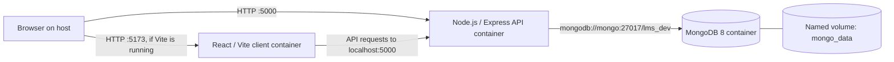
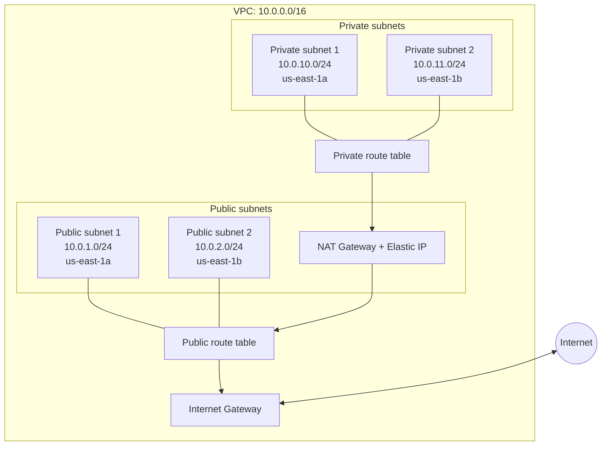

# Lab 01 — Lumen LMS: Docker, AWS Networking & Terraform

> **Purpose:** This document consolidates the recorded Lab 01 work for the Lumen LMS project: local Docker containerization, AWS network infrastructure, Terraform management, validation, and Git/GitHub workflow.
>
> **Accuracy note:** This is based on the project notes and command output shared so far. The Docker files and AWS resource IDs below were supplied in the conversation. Any check not supported by an actual result is described as a verification step, not as a confirmed success. The local project directory was not accessible from the document-generation environment, so this file has been created separately and has not been copied into the project's `docs/` directory.

## 1. Lab goals

By the end of this lab, the intended outcomes are:

1. Run the MERN LMS locally using Docker Compose.
2. Containerize the React frontend and Node.js backend, and run MongoDB with persistent storage.
3. Understand service networking, environment variables, health checks, bind mounts, and named volumes.
4. Represent the existing AWS network in Terraform without unintentionally replacing existing resources.
5. Validate that Terraform's configuration matches the existing infrastructure.
6. Commit the configuration to Git and push it to GitHub after authentication is completed.
7. Record security and cost considerations, especially the billable NAT Gateway and Elastic IP.

## 2. High-level architecture

### 2.1 Local development architecture



**Important configuration mismatch:** `compose.yaml` publishes the client as `5173:5173`, but `client/Dockerfile` builds static files and serves them with Nginx on port `80`. The Compose file also mounts source code into `/app`, while the final Nginx image serves `/usr/share/nginx/html`. This means the current Compose configuration and the production-style client Dockerfile describe different run modes. Verify the actual running configuration before treating the client port or hot reload as working.

### 2.2 AWS network architecture



The diagram shows the intended routing pattern. Confirm actual routes and associations in AWS Console/CLI and Terraform before relying on it operationally.

## 3. Repository and local environment

Project root used in the terminal:

```bash
cd /mnt/c/Users/Mo/Documents/lms-mern
```

The project includes a React client, a Node.js server, `compose.yaml`, and a `terraform/` directory. The local environment reported previously includes Windows 11 with WSL2/Ubuntu, Docker, Node.js, and Terraform. Versions can change; capture the actual versions when rerunning the lab:

```bash
uname -a
docker --version
docker compose version
node --version
npm --version
terraform version
git --version
```

**Why:** Version capture helps diagnose differences in Docker behavior, Node package installation, Terraform providers, and CLI commands.

## 4. Docker: concepts used in this lab

- **Image:** a packaged filesystem and metadata used to create containers.
- **Container:** a running or stopped instance of an image.
- **Dockerfile:** instructions for building an image.
- **Docker Compose:** a declarative file for running related services together.
- **Build context:** the files Docker can access while building an image.
- **Bind mount:** maps a host directory/file into a container, often used for local development.
- **Named volume:** storage managed by Docker, useful for database files and dependency directories.
- **Port mapping:** `HOST_PORT:CONTAINER_PORT`; it publishes a container port on the host.
- **Health check:** a command Docker runs to classify a service as healthy or unhealthy.
- **Service dependency:** Compose can wait for a dependency's health status before starting another service.

## 5. Docker files and implementation

### 5.1 `compose.yaml`

The current file defines `mongo`, `server`, and `client`.

#### MongoDB service

```yaml
services:
  mongo:
    image: mongo:8
    restart: unless-stopped
    volumes:
      - mongo_data:/data/db
```

- `services`: starts the Compose service definitions.
- `mongo`: the service name; other Compose services can resolve it through the Compose network.
- `image: mongo:8`: selects the MongoDB 8 image tag.
- `restart: unless-stopped`: restarts the service after unexpected exits unless it was explicitly stopped.
- `mongo_data:/data/db`: stores MongoDB's database files in a named volume, rather than only in the disposable container layer.

```yaml
    healthcheck:
      test:
        - CMD-SHELL
        - mongosh --quiet --eval "db.adminCommand('ping').ok" | grep -q 1
      interval: 5s
      timeout: 5s
      retries: 10
```

- `healthcheck`: configures a health probe.
- `CMD-SHELL`: runs through a shell, which enables the pipe `|`.
- `mongosh ... ping`: asks MongoDB to respond to a ping command and checks for result `1`.
- `--quiet`: reduces shell output.
- `interval: 5s`: runs the probe every five seconds.
- `timeout: 5s`: fails a probe that takes too long.
- `retries: 10`: marks the service unhealthy after the configured consecutive failures.

This check tests whether MongoDB responds to the ping; it does not prove that every application query or schema operation works.

#### Backend service

```yaml
  server:
    build:
      context: ./server
    restart: unless-stopped
    env_file:
      - ./server/.env
    environment:
      NODE_ENV: development
      PORT: "5000"
      CLIENT_URL: http://localhost:5173
      MONGO_URI: mongodb://mongo:27017/lms_dev
```

- `build.context: ./server`: builds the service from the `server/` directory, using its Dockerfile by default.
- `env_file`: loads environment variables from `server/.env`. Keep this file private and out of Git.
- `environment`: sets values directly in the container; these values take precedence over matching values loaded from `env_file` and image defaults.
- `NODE_ENV: development`: makes the Compose runtime a development configuration even though the Dockerfile sets `production` by default.
- `PORT: "5000"`: sets the expected API port.
- `CLIENT_URL`: intended frontend origin; the application must actually use it (for example, in CORS configuration) for it to have an effect.
- `MONGO_URI`: connects to MongoDB using service DNS name `mongo`, internal port `27017`, and database name `lms_dev`.

```yaml
    ports:
      - "5000:5000"
    volumes:
      - ./server:/app
      - server_node_modules:/app/node_modules
```

- `5000:5000`: publishes host port 5000 to container port 5000.
- `./server:/app`: bind-mounts local source code into the container. This is useful during development, but hides image contents at `/app` while mounted.
- `server_node_modules:/app/node_modules`: preserves container dependencies in a separate named volume so the source bind mount does not replace them with host `node_modules`.
- A source bind mount does not itself restart Node.js on file changes; that requires an appropriate watcher or explicit restart.

```yaml
    depends_on:
      mongo:
        condition: service_healthy
```

Compose waits for MongoDB to become healthy before starting the backend. The application should still handle connection drops and reconnects.

```yaml
    healthcheck:
      test:
        - CMD
        - node
        - -e
        - "fetch('http://127.0.0.1:5000/api/health').then(r => process.exit(r.ok ? 0 : 1)).catch(() => process.exit(1))"
      interval: 10s
      timeout: 5s
      retries: 10
      start_period: 20s
```

- `CMD`: executes the command directly rather than through a shell.
- `node -e`: executes the inline JavaScript expression.
- `fetch(...)`: requests the API health endpoint from inside the backend container.
- `r.ok`: succeeds for an HTTP status in the 200–299 range.
- `process.exit(0)` signals success; exit code `1` signals failure.
- `start_period: 20s` gives the app an initial startup allowance.
- This check only works if the backend actually serves `/api/health` on port 5000 and the runtime's Node version supports the used `fetch` API.

#### Frontend service

```yaml
  client:
    build:
      context: ./client
      args:
        VITE_API_BASE_URL: http://localhost:5000/api
        VITE_SITE_URL: http://localhost:5173
    restart: unless-stopped
    ports:
      - "5173:5173"
    volumes:
      - ./client:/app
      - client_node_modules:/app/node_modules
    depends_on:
      server:
        condition: service_healthy
```

- `context: ./client`: uses the client directory as build context.
- `args`: passes build arguments to `client/Dockerfile`; Vite values are typically compiled into the client bundle and must not contain secrets.
- `5173:5173`: publishes host port 5173 to container port 5173. This matches Vite's usual development port, but not the Nginx port in the provided Dockerfile.
- `./client:/app`: mounts source code in `/app`. It does not automatically update static files already copied to Nginx's `/usr/share/nginx/html`.
- `client_node_modules:/app/node_modules`: keeps the client dependencies in a Docker-managed volume.
- `depends_on` with `service_healthy`: waits for the backend health check before starting the client.

**Required review:** decide whether Compose should run a Vite development server or the Nginx production image. For Nginx, the host mapping would typically map a host port to container port 80 (for example `5173:80`), after confirming `nginx/default.conf`. For Vite development, use a development-specific command/configuration that explicitly starts Vite on `0.0.0.0:5173`. Do not silently mix these two modes.

#### Named volumes

```yaml
volumes:
  mongo_data:
  server_node_modules:
  client_node_modules:
```

- `mongo_data`: database persistence.
- `server_node_modules`: backend dependencies.
- `client_node_modules`: frontend dependencies.

`docker compose down` normally preserves named volumes. `docker compose down -v` removes project volumes and can delete database data; do not run it unless data deletion is intended.

### 5.2 `client/Dockerfile`

```dockerfile
FROM node:22-alpine AS builder
WORKDIR /app
COPY package*.json ./
RUN npm ci
```

- `FROM node:22-alpine AS builder`: uses Node 22 on Alpine as the build stage and names it `builder`.
- `WORKDIR /app`: sets the working directory.
- `COPY package*.json ./`: copies package manifests and lockfile if present.
- `RUN npm ci`: installs dependencies reproducibly from the lockfile; a compatible lockfile is required.

```dockerfile
ARG VITE_API_BASE_URL=http://localhost:5000/api
ARG VITE_SITE_URL=http://localhost:5173
ENV VITE_API_BASE_URL=${VITE_API_BASE_URL}
ENV VITE_SITE_URL=${VITE_SITE_URL}
COPY . .
RUN npm run build
```

- `ARG` declares build-time values with defaults.
- `ENV` exposes those values to later build commands.
- `COPY . .` copies the rest of the frontend source into the image.
- `npm run build` runs the build script from `package.json`, typically producing static files in `dist/`.
- `VITE_*` values are public client-side configuration after compilation; never place credentials in them.

```dockerfile
FROM nginx:alpine
COPY nginx/default.conf /etc/nginx/conf.d/default.conf
COPY --from=builder /app/dist /usr/share/nginx/html
EXPOSE 80
```

- Starts a new, smaller runtime stage based on Nginx.
- Copies the custom Nginx configuration into the image.
- Copies only the compiled frontend assets from the `builder` stage.
- `EXPOSE 80` documents the container port; it does not publish that port to the host by itself.

```dockerfile
HEALTHCHECK --interval=30s --timeout=3s --start-period=5s --retries=3 \
  CMD wget -q -O /dev/null http://127.0.0.1/health || exit 1
```

Docker probes `/health` every 30 seconds, allows three seconds per probe, gives a five-second startup period, and tolerates three consecutive failures. This requires `nginx/default.conf` to return a successful response for `/health`. Verify that route in the actual Nginx configuration.

### 5.3 `server/Dockerfile`

```dockerfile
FROM node:20-alpine
ENV NODE_ENV=production
WORKDIR /app
COPY package*.json ./
RUN npm ci --omit=dev && npm cache clean --force
COPY --chown=node:node . .
USER node
EXPOSE 5000
CMD ["npm", "start"]
```

- `FROM node:20-alpine`: selects Node 20 on Alpine. Confirm runtime compatibility and supported security updates for the chosen Node release.
- `ENV NODE_ENV=production`: sets the image's default environment to production.
- `WORKDIR /app`: selects the application directory.
- `COPY package*.json ./`: copies package manifests/lockfile first to improve layer caching.
- `npm ci --omit=dev`: installs production dependencies only; `npm cache clean --force` clears npm cache to reduce leftover data.
- `COPY --chown=node:node . .`: copies application files and assigns ownership to the `node` user.
- `USER node`: runs the process without root privileges.
- `EXPOSE 5000`: documents the expected app port.
- `CMD ["npm", "start"]`: starts the package's `start` script using exec form.

**Compose override:** the current Compose file sets `NODE_ENV: development`, overriding the image default. It also bind-mounts source code. Therefore, the effective Compose runtime is not the same as running this Dockerfile alone as a production image.

### 5.4 `.dockerignore` files

Both client and server ignore these common paths:

```dockerignore
node_modules
.env
.env.*
!.env.example
.git
.gitignore
npm-debug.log*
coverage
```

The client additionally ignores `dist`.

- `node_modules`: excludes machine-specific installed dependencies from the build context.
- `.env` and `.env.*`: prevents environment files from being sent in the build context.
- `!.env.example`: permits a non-secret example file after the broader environment-file ignore rule.
- `.git` and `.gitignore`: excludes Git metadata and its ignore file from the build context.
- `npm-debug.log*`: excludes npm debug logs.
- `coverage`: excludes test coverage output.
- `dist` in the client: excludes old build output; the image creates a fresh build.

`.dockerignore` does **not** stop Git from tracking a file. Use `.gitignore` too, and never commit real secrets.

## 6. Docker execution and validation sequence

Run these from the repository root. Record the actual output and do not mark a test passed unless it succeeds.

### Step 1 — Validate Compose syntax

```bash
docker compose -f compose.yaml config --quiet
```

**Why:** catches invalid Compose YAML and configuration errors before starting containers. Success means the configuration parses; it does not guarantee that all services will work.

### Step 2 — Build images

```bash
docker compose -f compose.yaml build
```

**Why:** checks Dockerfiles, dependency installation, build arguments, and frontend compilation.

### Step 3 — Start services

```bash
docker compose -f compose.yaml up -d
```

**Why:** creates/starts the defined containers in the background.

### Step 4 — Inspect service state

```bash
docker compose -f compose.yaml ps
docker compose -f compose.yaml logs --tail=100 mongo
docker compose -f compose.yaml logs --tail=100 server
docker compose -f compose.yaml logs --tail=100 client
```

**Why:** shows container state and helps diagnose startup, port, health-check, database, or Nginx errors.

### Step 5 — Check backend endpoint

```bash
curl -i http://localhost:5000/api/health
```

A successful endpoint should return an HTTP 2xx response if implemented that way. Confirm the route in the backend code.

### Step 6 — Check frontend

Open the intended host URL only after confirming whether the container runs Vite or Nginx. With the provided production Nginx Dockerfile, verify that host port 5173 maps to container port 80 (or another explicitly configured Nginx port). Do not infer success solely from the Compose port declaration.

### Step 7 — Verify database persistence

1. Create a harmless test record in a test database/collection.
2. Query it and record the result.
3. Restart MongoDB:

   ```bash
   docker compose -f compose.yaml restart mongo
   ```

4. Wait for the MongoDB service to become healthy.
5. Query the same record again.

If the record remains, this confirms persistence across a container restart with the named volume mounted. A prior project note states that a test record in the separate `docker_lab` database survived a MongoDB container restart; repeat the test if you need fresh evidence for this revision.

### Step 8 — Stop safely

```bash
docker compose -f compose.yaml down
```

This stops and removes containers/network created by Compose while normally preserving named volumes. Avoid `down -v` unless you intentionally want to remove persistent volumes.

## 7. AWS Networking — existing infrastructure recorded

**AWS region:** `us-east-1`

| Resource | Name / CIDR | Recorded resource ID |
|---|---|---|
| VPC | `nti-devops-vpc`, `10.0.0.0/16` | `vpc-0b8a40513428f598b` |
| Public subnet 1 | `10.0.1.0/24`, `us-east-1a` | `subnet-025596c15d0690a73` |
| Public subnet 2 | `10.0.2.0/24`, `us-east-1b` | `subnet-03ea90693f84b602d` |
| Private subnet 1 | `10.0.10.0/24`, `us-east-1a` | `subnet-09b87be84bc4c3dcf` |
| Private subnet 2 | `10.0.11.0/24`, `us-east-1b` | `subnet-00cd75c0d797d5d16` |
| Internet Gateway | `nti-devops-igw` | `igw-0927ab8e225d4e670` |
| NAT Gateway | `nti-devops-nat` | `nat-0c42550a611bd6e31` |
| NAT public IP | `44.219.120.137` | — |
| Elastic IP allocation | — | `eipalloc-01e8b06f724b3feb6` |
| Public route table | `nti-devops-public-rt` | `rtb-0aa1bbe92eb40ec12` |
| Private route table | `nti-devops-private-rt` | `rtb-03ed4a8bb0c611ebe` |

These identifiers are a snapshot from the supplied project context; verify them in the AWS account before running state-changing commands.

### 7.1 Why each network resource exists

- **VPC (`10.0.0.0/16`):** isolated IP network for project resources.
- **Public subnets:** intended for resources that need a route to the Internet Gateway, such as a public load balancer or NAT Gateway.
- **Private subnets:** intended for resources that should not receive direct inbound Internet connections.
- **Internet Gateway (IGW):** provides an Internet route for eligible resources in public subnets when routes and public addressing/security rules allow it.
- **NAT Gateway:** lets resources in private subnets initiate outbound IPv4 connections without making those private resources directly reachable from the Internet. A NAT Gateway in a public subnet requires a route to the IGW and typically an Elastic IP.
- **Elastic IP:** stable public IPv4 address associated with the NAT Gateway.
- **Public route table:** should have a default route such as `0.0.0.0/0` to the IGW.
- **Private route table:** should have a default route such as `0.0.0.0/0` to the NAT Gateway if private instances need outbound IPv4 Internet access.
- **Subnet route-table associations:** connect each subnet to the route table that governs its routing.

A resource being named “public” or “private” does not alone make it so; verify route tables, public IP assignment, security groups, network ACLs, and actual resource placement.

## 8. Terraform implementation

### 8.1 Recorded layout

```text
terraform/
├── .terraform.lock.hcl
├── versions.tf
├── providers.tf
├── variables.tf
├── main.tf
└── modules/
    └── vpc/
        ├── main.tf
        └── variables.tf
```

- `versions.tf`: Terraform and provider version constraints.
- `providers.tf`: AWS provider configuration, including region.
- `variables.tf`: root module inputs.
- `main.tf`: root module resources/module calls.
- `modules/vpc/main.tf`: VPC and related network resource definitions.
- `modules/vpc/variables.tf`: inputs required by the VPC module.
- `.terraform.lock.hcl`: locks selected provider versions/checksums for reproducible initialization.

### 8.2 Why import existing resources?

The AWS network existed before Terraform management. Importing lets Terraform associate existing AWS resource IDs with Terraform resource addresses so the configuration can manage them without intentionally creating duplicate resources.

**Import is not a backup and does not automatically make configuration correct.** After import, compare the configuration with actual AWS attributes and review the plan carefully.

### 8.3 State and validation workflow

From the project root:

```bash
cd /mnt/c/Users/Mo/Documents/lms-mern/terraform
terraform init
terraform fmt -recursive
terraform validate
terraform state list
terraform plan
```

- `terraform init`: initializes the working directory and downloads providers/modules as needed.
- `terraform fmt -recursive`: formats Terraform files, including module files.
- `terraform validate`: checks configuration structure and types after initialization.
- `terraform state list`: shows resources currently tracked in state.
- `terraform plan`: compares declared configuration and state/provider observations to propose changes.

**Recorded result:** the project had 14 resources in Terraform state, and `terraform plan` reported: `No changes. Your infrastructure matches the configuration.` This indicates that, at that time and with that state/configuration, Terraform proposed no changes. It is not a guarantee that every operational or security requirement is correct.

Do not run `terraform apply` simply to “finish” a lab if the plan is already empty. If a plan proposes deletion/replacement, stop and understand why before applying.

### 8.4 Route-table associations

The project notes state that route-table associations were imported and aligned with the existing network. The private association mapping uses:

```hcl
aws_subnet.private[1 - count.index].id
```

This expression reverses the private subnet index for the association mapping: when `count.index` is 0 it selects index 1, and when it is 1 it selects index 0. This can be intentional when matching an existing association ordering, but it is less obvious than a direct mapping. Document the reason in a code comment and verify the actual subnet-to-route-table associations before changing it.

### 8.5 State safety

- Terraform state can contain sensitive infrastructure details; keep it out of Git.
- `.gitignore` should exclude `.terraform/`, `*.tfstate`, `*.tfstate.*`, and `*.tfplan`.
- `.terraform.lock.hcl` should normally be committed so the provider selection is reproducible.
- Do not delete or recreate imported resources just to make a plan look clean.
- Before any apply, review the full plan, especially any `destroy` or replacement action.
- For team/production usage, evaluate a secured remote backend with locking and access control; do not casually move local state without a migration plan.

## 9. Git and GitHub workflow

### 9.1 Inspect the working tree

From the repository root:

```bash
git status --short
git branch --show-current
git remote -v
git log -5 --oneline
```

These commands show uncommitted changes, current branch, configured remotes, and recent commits.

### 9.2 Recorded commit

The Terraform Lab 01 commit recorded in the project context is:

```text
18420f7 feat: manage Lab 01 AWS networking with Terraform
```

The working tree was reported clean after that commit. Verify locally before relying on the record:

```bash
git status --short
git show --stat --oneline 18420f7
```

### 9.3 GitHub authentication and push

GitHub CLI authentication had not yet been confirmed in the last reported terminal state. Check it first:

```bash
gh auth status
```

If not authenticated, run:

```bash
gh auth login
```

Follow the CLI's browser/device authorization instructions to completion; do not cancel the process before confirming authorization. Then configure Git to use GitHub CLI credentials and push:

```bash
gh auth setup-git
git push -u origin main
```

If the repository uses another branch, use the actual branch shown by `git branch --show-current`. Never paste an access token or password into chat. If push fails, inspect `gh auth status`, `git remote -v`, and the exact error before changing remotes or credentials.

## 10. Security and cost checklist

### Docker/local environment

- Keep real `.env` files out of Git and image build contexts.
- Never put passwords, API keys, or tokens in `VITE_*` variables; client-side values are visible to users.
- MongoDB is not directly published to the host in the provided Compose file.
- The backend image uses the non-root `node` user, but confirm the actual runtime and filesystem permissions.
- The current client Compose port/runtime mismatch must be resolved and retested.

### AWS

- **NAT Gateway is billable** while provisioned, and data processing/transfer can add charges.
- Review Elastic IP billing/association status and current AWS pricing for the account/region.
- Do not delete the NAT Gateway or Elastic IP as a cleanup shortcut; they are part of the recorded network and deletion can disrupt connectivity.
- Do not publish private keys, AWS credentials, account identifiers that should remain private, or Terraform state.
- Use least-privilege IAM credentials and avoid embedding credentials in provider configuration.
- Before changing network resources, verify dependencies and review the Terraform plan.

## 11. Troubleshooting guide

| Symptom | What to inspect |
|---|---|
| Compose configuration fails | Run `docker compose config`; inspect YAML indentation, variable interpolation, and paths. |
| Image build fails | Inspect the relevant build output, `package.json`, lockfile, Dockerfile, and `.dockerignore`. |
| Backend cannot reach MongoDB | Check `MONGO_URI` uses `mongo:27017`, then inspect MongoDB health and backend logs. |
| Backend health check fails | Confirm the app listens on port 5000 and implements `/api/health`. |
| Frontend is unavailable on 5173 | Check whether Vite or Nginx is running and align the container port mapping. |
| Frontend changes do not appear | Determine whether the image serves static Nginx files or runs Vite; source bind mounts do not update Nginx's copied build output. |
| MongoDB data appears missing | Confirm `mongo_data` is mounted and the same Compose project/volume is being used; check whether `down -v` was run. |
| Terraform proposes replacement/deletion | Stop before applying; compare configuration, imported IDs, state, and actual AWS attributes. |
| Terraform says credentials are missing | Verify AWS CLI/profile/role configuration locally; never share credentials in chat. |
| Git push says not logged in | Complete `gh auth login`, check `gh auth status`, then run `gh auth setup-git`. |

## 12. End-of-lab checklist

Use this checklist when re-running or formally closing Lab 01:

- [ ] Docker and Docker Compose versions captured.
- [ ] `docker compose config --quiet` succeeds.
- [ ] Client and server images build successfully.
- [ ] MongoDB, backend, and frontend service states inspected.
- [ ] Backend health endpoint returns the expected status.
- [ ] Frontend port/runtime mismatch resolved and verified.
- [ ] MongoDB persistence tested after container restart.
- [ ] AWS VPC, subnet, IGW, NAT, EIP, route tables, and associations verified.
- [ ] Terraform state and imported resources inspected.
- [ ] `terraform fmt -recursive` and `terraform validate` succeed.
- [ ] `terraform plan` reviewed; no unexpected changes remain.
- [ ] State files and secrets excluded from Git.
- [ ] Git commit verified and GitHub push confirmed.
- [ ] NAT Gateway and Elastic IP costs considered; no resources deleted unintentionally.

## 13. Final outcome and next step

Lab 01 covers two related but distinct deliverables: (1) local containerization of the Lumen LMS using Docker/Compose, and (2) management of the existing AWS network through Terraform. The Docker files describe a multi-stage Nginx frontend image and a Node.js backend image, while Compose currently contains development-oriented mounts and settings that need to be reconciled with those image definitions. The AWS network resources were imported into Terraform, and the recorded plan result was `No changes`.

**Before moving on:** resolve and test the frontend runtime/port mismatch, rerun the Docker validations, verify Terraform state and plan against the current AWS account, and finish GitHub authentication/push. Do not start Lab 02 until Lab 01 has been reviewed and the user explicitly asks to continue.

---

# Appendix A — Complete source files provided for this documentation

This appendix preserves the complete contents of the Docker files pasted into the conversation. These are included as source listings so the document can be used as a reference. If you later change the project files, update these copies too.

## A.1 Complete `compose.yaml`

```yaml
services:
  mongo:
    image: mongo:8
    restart: unless-stopped
    volumes:
      - mongo_data:/data/db
    healthcheck:
      test:
        - CMD-SHELL
        - mongosh --quiet --eval "db.adminCommand('ping').ok" | grep -q 1
      interval: 5s
      timeout: 5s
      retries: 10

  server:
    build:
      context: ./server
    restart: unless-stopped
    env_file:
      - ./server/.env
    environment:
      NODE_ENV: development
      PORT: "5000"
      CLIENT_URL: http://localhost:5173
      MONGO_URI: mongodb://mongo:27017/lms_dev
    ports:
      - "5000:5000"
    volumes:
      - ./server:/app
      - server_node_modules:/app/node_modules
    depends_on:
      mongo:
        condition: service_healthy
    healthcheck:
      test:
        - CMD
        - node
        - -e
        - "fetch('http://127.0.0.1:5000/api/health').then(r => process.exit(r.ok ? 0 : 1)).catch(() => process.exit(1))"
      interval: 10s
      timeout: 5s
      retries: 10
      start_period: 20s

  client:
    build:
      context: ./client
      args:
        VITE_API_BASE_URL: http://localhost:5000/api
        VITE_SITE_URL: http://localhost:5173
    restart: unless-stopped
    ports:
      - "5173:5173"
    volumes:
      - ./client:/app
      - client_node_modules:/app/node_modules
    depends_on:
      server:
        condition: service_healthy

volumes:
  mongo_data:
  server_node_modules:
  client_node_modules:
```

### A.1 explanation of the complete Compose file

- `services`: declares the containers managed together by Compose.
- `mongo`: MongoDB service name and internal DNS name.
- `image: mongo:8`: selects MongoDB major version 8.
- `restart: unless-stopped`: restarts after unexpected exits unless explicitly stopped.
- `mongo_data:/data/db`: persists database files in a named volume.
- Mongo health check: runs `mongosh` and a MongoDB `ping` command; `grep -q 1` checks for a successful result.
- `build.context: ./server` and `./client`: choose the directories sent as build contexts; each directory's `Dockerfile` is used by default.
- `env_file`: loads variables from `server/.env`; keep the real file private.
- `environment`: supplies runtime variables. These Compose values override matching values from the image and, where duplicated, the `env_file` values.
- `MONGO_URI`: uses `mongo`, not `localhost`, because containers communicate through the Compose network using service names.
- `ports`: publishes a container port on the host using `HOST:CONTAINER` syntax.
- Bind mounts `./server:/app` and `./client:/app`: expose local source code inside the container; they can hide files that were present in `/app` in the image.
- Named `*_node_modules` volumes: keep container dependencies separate from host dependencies.
- `depends_on` with `condition: service_healthy`: waits for the dependency's health check before starting the dependent service.
- Backend health check: calls `http://127.0.0.1:5000/api/health` from inside the backend container and returns success only for HTTP 2xx.
- `start_period`: gives the backend extra startup time before health-check failures count normally.
- `args`: sends build arguments into the frontend Dockerfile. `VITE_*` values are public client configuration, not secrets.
- The client publishes `5173:5173`, but the supplied client Dockerfile's final Nginx process listens on port 80. This is a real configuration mismatch unless Nginx has been explicitly configured to listen on 5173. Review before changing the mapping.
- The final named-volume declarations define persistent Docker-managed volumes. `docker compose down` normally retains them; `docker compose down -v` deletes project volumes and may delete MongoDB data.

## A.2 Complete `client/Dockerfile`

```dockerfile
# Stage 1: Build the React application
FROM node:22-alpine AS builder

WORKDIR /app

COPY package*.json ./
RUN npm ci

ARG VITE_API_BASE_URL=http://localhost:5000/api
ARG VITE_SITE_URL=http://localhost:5173

ENV VITE_API_BASE_URL=${VITE_API_BASE_URL}
ENV VITE_SITE_URL=${VITE_SITE_URL}

COPY . .
RUN npm run build

# Stage 2: Serve production files with Nginx
FROM nginx:alpine

COPY nginx/default.conf /etc/nginx/conf.d/default.conf
COPY --from=builder /app/dist /usr/share/nginx/html

EXPOSE 80

HEALTHCHECK --interval=30s --timeout=3s --start-period=5s --retries=3 \
  CMD wget -q -O /dev/null http://127.0.0.1/health || exit 1
```

### A.2 line-by-line explanation

- `FROM node:22-alpine AS builder`: creates the build stage using Node.js 22 on Alpine Linux and labels it `builder`.
- `WORKDIR /app`: sets the working directory for following instructions.
- `COPY package*.json ./`: copies the package manifest and lockfile before the rest of the source to improve build-layer caching.
- `RUN npm ci`: installs packages according to the lockfile; a compatible lockfile must exist.
- `ARG VITE_API_BASE_URL` and `ARG VITE_SITE_URL`: declare values that can be supplied at image build time.
- `ENV ...`: exposes the values to the build command. Vite generally compiles `VITE_*` values into client assets, so do not put secrets there.
- `COPY . .`: copies the remaining build context into `/app`, subject to `.dockerignore`.
- `RUN npm run build`: runs the package's build script; the Dockerfile expects build output in `/app/dist`.
- `FROM nginx:alpine`: starts the final runtime stage. It does not inherit Node.js or the builder's full filesystem.
- `COPY nginx/default.conf ...`: installs the custom Nginx site configuration. The source file must exist in the client build context.
- `COPY --from=builder /app/dist /usr/share/nginx/html`: copies only built static files into Nginx's web root.
- `EXPOSE 80`: documents the expected container port; it does not publish it on the host.
- `HEALTHCHECK`: probes `/health` inside the container every 30 seconds, allows three seconds per probe, uses a five-second startup period, and retries three times. The Nginx configuration must return a successful status for this route; verify the actual `nginx/default.conf`.

## A.3 Complete `client/.dockerignore`

```dockerignore
node_modules
dist
.env
.env.*
!.env.example
.git
.gitignore
npm-debug.log*
coverage
```

Explanation:

- `node_modules`: excludes local dependencies from the build context; the image installs its own dependencies.
- `dist`: excludes any old local build output so the image builds fresh output.
- `.env` and `.env.*`: excludes environment files from the Docker build context.
- `!.env.example`: re-allows a safe example file after the preceding ignore patterns.
- `.git` and `.gitignore`: excludes repository metadata and the ignore file from the context.
- `npm-debug.log*`: excludes npm debug logs.
- `coverage`: excludes test coverage artifacts.

## A.4 Complete `server/Dockerfile`

```dockerfile
FROM node:20-alpine

ENV NODE_ENV=production

WORKDIR /app

COPY package*.json ./

RUN npm ci --omit=dev && npm cache clean --force

COPY --chown=node:node . .

USER node

EXPOSE 5000

CMD ["npm", "start"]
```

### A.4 line-by-line explanation

- `FROM node:20-alpine`: selects Node.js 20 on Alpine Linux. Confirm that the selected Node release remains supported and compatible with the project.
- `ENV NODE_ENV=production`: sets the image default to production mode. Compose currently overrides this with `development` for this service.
- `WORKDIR /app`: sets the application directory.
- `COPY package*.json ./`: copies package files before application source to improve layer caching.
- `RUN npm ci --omit=dev`: installs production dependencies and omits development dependencies. It requires a compatible lockfile.
- `npm cache clean --force`: clears npm's cache to reduce unnecessary data in the image layer.
- `COPY --chown=node:node . .`: copies the application and assigns ownership to the `node` user.
- `USER node`: runs the application as a non-root user.
- `EXPOSE 5000`: documents the port the application is expected to listen on.
- `CMD ["npm", "start"]`: runs the `start` script from `package.json` using Docker's exec form.

## A.5 Complete `server/.dockerignore`

```dockerignore
node_modules
.env
.env.*
!.env.example
.git
.gitignore
npm-debug.log*
coverage
```

The rules exclude local dependencies, real environment files, Git metadata, npm debug logs, and coverage output. The exception permits a non-secret `.env.example` file. This affects the Docker build context only; it does not replace `.gitignore` and does not remove files already tracked by Git.

---

# Appendix B — Terraform code coverage and exact-source limitation

The following Terraform file names and one expression are confirmed by the project notes:

```text
terraform/.terraform.lock.hcl
terraform/versions.tf
terraform/providers.tf
terraform/variables.tf
terraform/main.tf
terraform/modules/vpc/main.tf
terraform/modules/vpc/variables.tf
```

The recorded route-table association expression is:

```hcl
aws_subnet.private[1 - count.index].id
```

This selects private subnet index 1 when `count.index` is 0, and index 0 when `count.index` is 1. The project notes say this reverse mapping was intentional to align associations with the existing AWS network. Verify the matching resource block before modifying it.

**Important completeness note:** the full contents of the Terraform `.tf` files, `client/nginx/default.conf`, root `.gitignore`, `package.json` files, and actual historical shell transcript were not supplied in the messages available when this document was assembled. They are therefore not reproduced as if they were the original source. To make a truly line-by-line record of those files, paste their current contents into this document's next revision or provide the project archive. The AWS resource IDs, Terraform state count, and recorded no-change plan are preserved in the main sections above; verify them against the live account before any change.

# Appendix C — Reproducible command log template

Use this section to record real outputs whenever the lab is rerun. Do not paste credentials, tokens, private keys, or secret environment values into the log.

```bash
# From project root
pwd
docker --version
docker compose version
docker compose -f compose.yaml config --quiet
docker compose -f compose.yaml build
docker compose -f compose.yaml up -d
docker compose -f compose.yaml ps
docker compose -f compose.yaml logs --tail=100 mongo
docker compose -f compose.yaml logs --tail=100 server
docker compose -f compose.yaml logs --tail=100 client
curl -i http://localhost:5000/api/health

# Stop containers but preserve named volumes
docker compose -f compose.yaml down

# Terraform: run from terraform/ after verifying AWS credentials/profile
terraform init
terraform fmt -recursive
terraform validate
terraform state list
terraform plan

# Git: run from repository root
git status --short
git branch --show-current
git remote -v
git log -5 --oneline
gh auth status
```

For every command, record: (1) purpose, (2) exit status, (3) important output, (4) any error and fix, and (5) whether the result was verified. Never store access tokens or secret values in this document.
